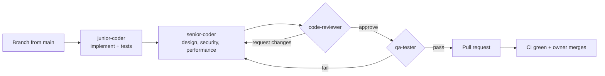

# Contributing

## Workflow

1. **Branch** from an up-to-date `main`:
   `feat/<topic>`, `fix/<topic>`, `chore/<topic>`, `docs/<topic>`.
2. **Build** in small, conventional commits:
   `feat(app): add study timer`, `fix(api): reject expired pairing codes`, `test(app): cover OTP resend`.
3. **Pipeline:** every change, by a person or by Claude, goes through the four agents in `.claude/agents/`. In Claude Code, `/ship <task>` runs the whole pipeline.
4. **Open a PR** with the template. CI must pass: backend lint, typecheck, tests and build; app format, analyze and tests.
5. **Merge:** the owner merges with **Squash and merge**, then deletes the branch.

## Definition of done
- [ ] Tests cover the new behaviour, and all suites pass locally and in CI.
- [ ] No product rule is weakened (see `CLAUDE.md`).
- [ ] Works on a real Android phone: small screen, large text, offline.
- [ ] `README.md` and `.gitignore` are updated if needed.
- [ ] No secrets, keys or `.env` files committed.
