<div align="center">


# Study Mate

**Study smart. Unlock by learning.**

Pick what you'll study, lock distracting apps, and win them back by passing a quick AI quiz.

[](https://github.com/Ashfaq1306/study-mate/actions/workflows/ci.yml)


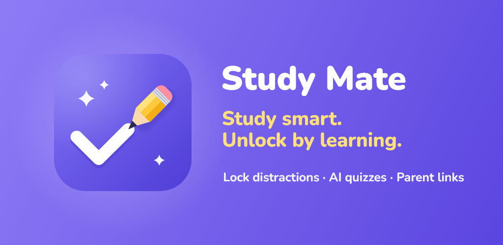

</div>

---

## How it works

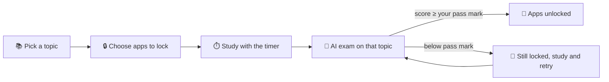

- **You set the rules.** Choose the exam pattern, total marks and pass mark. The pass mark can be anything from 50% up.
- **No shortcuts.** A locked app stays locked until the exam is passed.
- **Family built in.** Students under 15 link a parent by QR code. Parents can see screen time, block apps and write their own questions.
- **An AI study buddy.** Ask questions about what you're learning, any time (it takes a break while your exam is open).

## Screenshots

<table>
  <tr>
    <td align="center">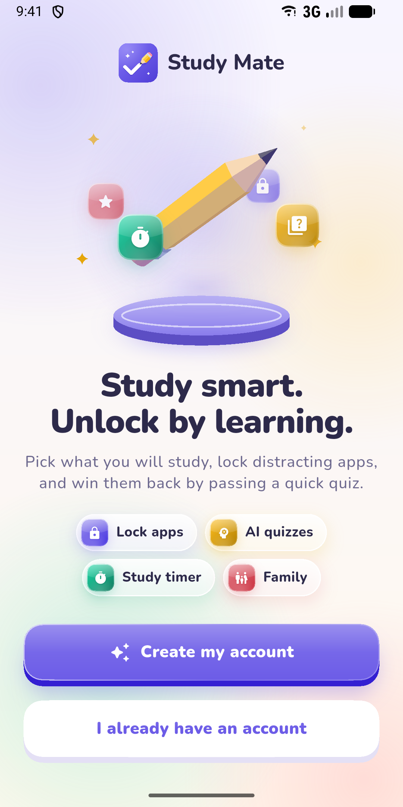<br/><sub>Welcome</sub></td>
    <td align="center">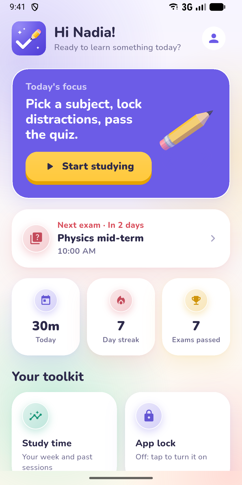<br/><sub>Student home</sub></td>
    <td align="center">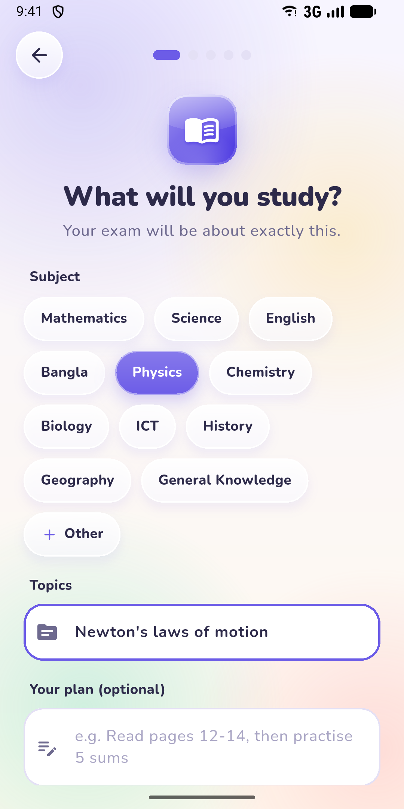<br/><sub>Pick what you'll study</sub></td>
    <td align="center">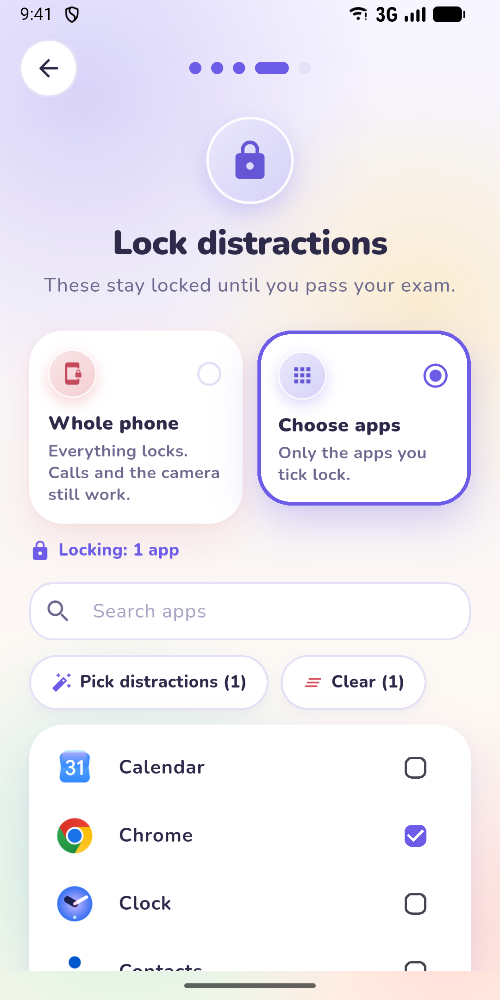<br/><sub>Lock distractions</sub></td>
    <td align="center">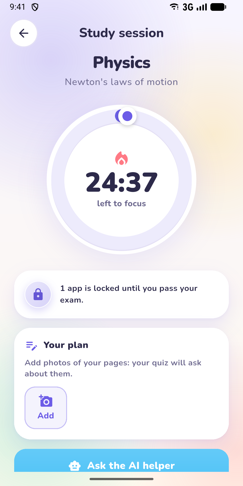<br/><sub>Focus timer</sub></td>
  </tr>
  <tr>
    <td align="center">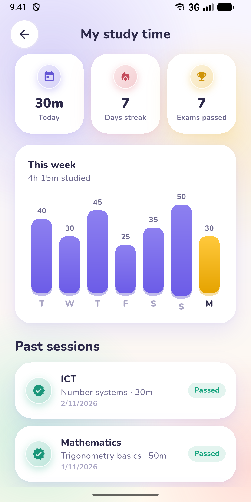<br/><sub>Study time and streaks</sub></td>
    <td align="center">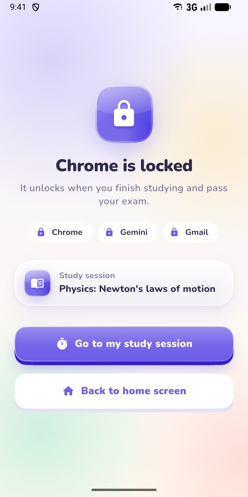<br/><sub>A locked app</sub></td>
    <td align="center">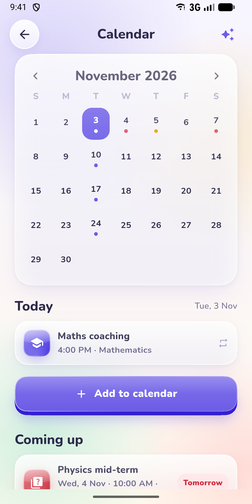<br/><sub>Calendar and reminders</sub></td>
    <td align="center">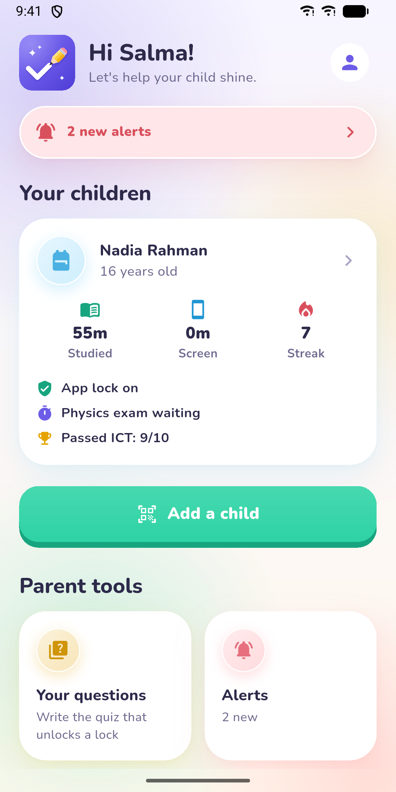<br/><sub>Parent home</sub></td>
    <td align="center">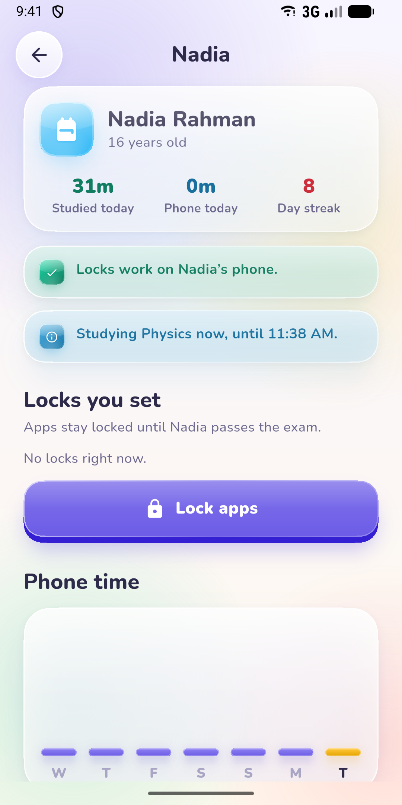<br/><sub>Child's progress</sub></td>
  </tr>
</table>

## Features

| | Feature | Status |
| --- | --- | --- |
| 👤 | Accounts with email **or** SMS one-time codes, password reset, delete your account in the app | ✅ Done |
| 👨‍👩‍👧 | Parent ↔ student linking by QR (required under 15) | ✅ Done |
| 💎 | **Liquid-glass design** (v1.1): frosted glass cards with light-catching edges, glossy squircle icon tiles instead of flat stickers, glass buttons, chips, menus and dialogs, readable colour contrast (WCAG AA), light and dark mode. See [docs/design-system.md](docs/design-system.md) | ✅ Done |
| ⏱️ | Study sessions: subject and topics, timer on server time, finish-early rule, stats, streaks and history | ✅ Done |
| 🔒 | App blocker: lock chosen apps or the whole phone; strict mode blocks Settings and uninstalls; calls and the camera always work | ✅ Done |
| 📝 | AI-generated exams on what you studied (and on photos of your pages): multiple choice, true/false and short answers, timed, graded with feedback; pass mark ≥ 50% | ✅ Done |
| 🤖 | AI study helper chat in English or Bangla (pauses during exams, daily limit); students can report a bad AI answer | ✅ Done |
| 📅 | Calendar: exams, weekly classes, assignments and holidays with phone reminders; the AI imports a school academic calendar from a PDF, photo or text | ✅ Done |
| 🌗 | Light and dark mode, six accent colours, home-screen widget | ✅ Done |
| 📊 | Parent dashboard: each child at a glance, screen time, study time, exams, app-lock status, remote locks unlocked by a quiz, parent-written questions, alerts | ✅ Done |
| 🛠️ | **Control Room** (admin panel, in the app for admin accounts and on the web at `/admin/`): live overview, who is online and when they signed in or out, study time per student and subject, activity log, unlock a phone without the exam, sign out, reset password, disable accounts, AI reports, every rule and subject | ✅ Done |
| 🩺 | **AI health check**: the server tests the AI key at start-up and every 30 minutes; the Control Room shows *AI is working* or exactly what to fix, with a **Check now** button | ✅ Done |
| ☁️ | Hosted on **Render** (Singapore): API + Postgres, deployed automatically after CI passes; phones find the server by themselves | ✅ Done |
| 🔄 | Updates: Google Play in-app updates for store installs; test builds update themselves from GitHub Releases | ✅ Done |
| ✉️ | Real one-time codes by email (Gmail SMTP); SMS when an SMS provider is set up | ✅ Done |

## Tech stack

| Part | Stack |
| --- | --- |
| **App** (`app/`) | Flutter 3.47, Riverpod 3, go_router 18, dio, flutter_secure_storage, mobile_scanner, qr_flutter, in_app_update |
| **API** (`backend/`) | Node 24, TypeScript, Fastify 5, Prisma 6, zod 4, vitest |
| **AI** | Google Gemini (default) or Anthropic Claude, chosen with `AI_PROVIDER`; built-in practice questions when no key is set |
| **Admin** (`admin/`) | Plain HTML, CSS and an ES module, served by the API (no build step) |
| **Hosting** | Render web service + Render Postgres ([render.yaml](render.yaml)); the app reads the server address from a small JSON file, so it can move without an app update |
| **Data** | SQLite for development; Postgres in production (CI tests both) |
| **Delivery** | SMTP email, Twilio SMS (both swappable; console output in development) |

More detail in [docs/architecture.md](docs/architecture.md), the [API reference](docs/api.md) and the [design system](docs/design-system.md).

## Getting started

### Prerequisites
- [Node.js 24](https://nodejs.org) and [Flutter 3.47+](https://docs.flutter.dev/get-started/install) with the Android SDK
- An Android phone with **USB debugging** on, or an emulator

### 1. Run the API
```bash
cd backend
npm ci
cp .env.example .env        # then set JWT_SECRET and OTP_SECRET (the file says how)
npm run db:push             # creates the local SQLite database
npm run dev                 # http://localhost:8080
```
In development, one-time codes are **printed in the API log** instead of being emailed or texted (look for `DEV OTP`). With `EXPOSE_DEV_CODES=true` (set in `.env.example`, refused in production) the app also shows the code on screen, so you can test on a phone without email or SMS.

### 2. Run the app
```bash
cd app
flutter pub get
adb reverse tcp:8080 tcp:8080   # lets the phone or emulator reach the API on your computer
flutter run                      # add --release to see real speed
```
For QA and screenshot builds, `--dart-define=UPDATE_REPO=` turns the self-updater off.

### 3. Production (Render)
The live API runs on Render from [render.yaml](render.yaml): a Node web service and a Postgres database in Singapore. Every merge to `main` deploys by itself once CI passes.

- **Secrets** are entered in the Render dashboard (study-assistant-api → Environment), never in the repo: `GEMINI_API_KEY` (from [Google AI Studio](https://aistudio.google.com/apikey)), `SMTP_USER`, `SMTP_PASS`, `SMTP_FROM`. After changing a key, open the Control Room and press **Check now** under the AI status.
- **Health:** `GET /health` returns `{"status":"ok","ai":"OK"}`. `ai` is `KEY_REJECTED` when the AI key stopped working.
- **Control Room:** https://ashfaq1306.github.io/study-mate/admin/ forwards to the live server.
- **Admins** are created only on the server: `npm run admin -- create you@example.com "Your Name"` (prints a one-time password).
- `scripts/move-to-render.ps1` moved the data from the old home-PC server to Render (done 3 Nov 2026). `scripts/serve-public.ps1` (home PC + Cloudflare tunnel) still works for running your own server.

## Launching on Google Play
Everything for the Play Console (listing text, screenshots, feature graphic, Data safety answers, the Accessibility declaration and a launch checklist) is in [docs/store](docs/store/README.md). Release builds are signed with the upload key named in `app/android/key.properties` (never committed); the privacy policy and account-deletion pages are at https://ashfaq1306.github.io/study-mate/privacy/ and https://ashfaq1306.github.io/study-mate/delete-account/.

## Testing
```bash
cd backend && npm run lint && npm run typecheck && npm test   # API tests (SQLite; CI also runs them on Postgres)
cd app && flutter analyze && flutter test test                 # app tests, including design-system contrast and layout checks
```
CI runs the same checks, plus the Kotlin app-lock tests, on every pull request.

## Project structure
```
study-mate/
├── app/                  Flutter app
│   ├── lib/app/          router, route guard, providers
│   ├── lib/core/         network, storage, theme + design tokens, liquid-glass widgets
│   ├── lib/features/     auth · study · exam · app_lock · calendar · tutor · parent · admin · …
│   ├── android/          Kotlin app-lock service (Accessibility) and widget
│   └── tool/             draws the launcher icons and Play artwork from code
├── admin/                web Control Room (served by the API at /admin/)
├── backend/              REST API
│   ├── prisma/           database schema
│   ├── src/modules/      auth · users · family · sessions · exams · ai · admin · reports · …
│   └── test/             API tests
├── docs/                 architecture, API, design system, Play store kit
├── scripts/              move-to-render · serve-public · install-autostart · configure-server · publish-test-build
├── render.yaml           Render blueprint (API + Postgres)
└── .claude/agents/       junior-coder · senior-coder · code-reviewer · qa-tester
```

## Contributing
Every change goes through a **junior → senior → reviewer → QA** pipeline and lands as a pull request. See [CONTRIBUTING.md](CONTRIBUTING.md) and [CLAUDE.md](CLAUDE.md).

## Security
- Passwords are hashed with scrypt. One-time codes and pairing codes are stored only as HMACs.
- Refresh tokens rotate on use; reusing an old one signs out every device in that session.
- Login answers the same way for unknown accounts and wrong passwords, and password reset never reveals whether an account exists.
- Sensitive endpoints are rate-limited per IP, and one-time codes per destination. Parallel guessing cannot get more than 5 tries.
- Only contacts that have received a code can be used to sign in or reset a password.
- On the phone, tokens are kept in the Android Keystore through `flutter_secure_storage`.
- API keys live only in the server's environment; the AI health check reports a state, never the key.
