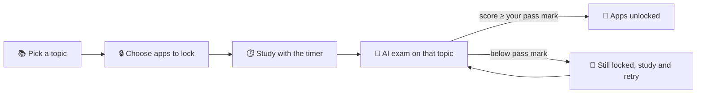
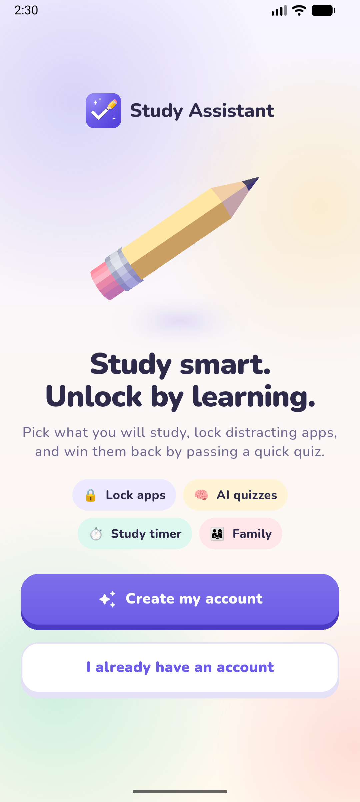
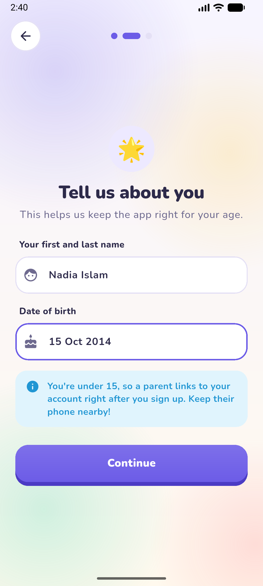
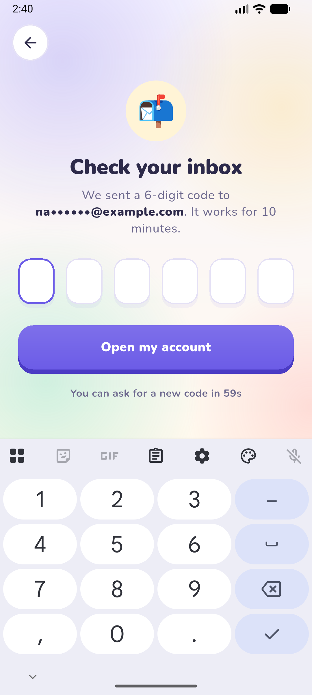
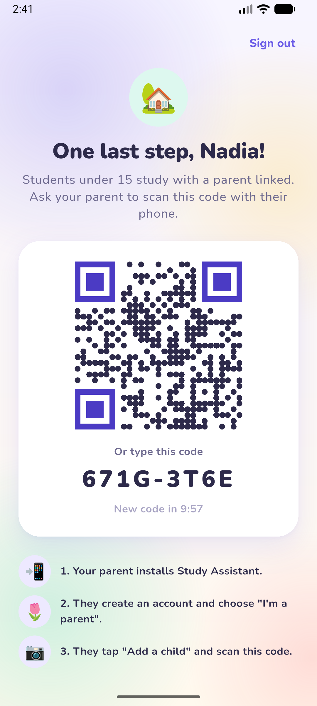
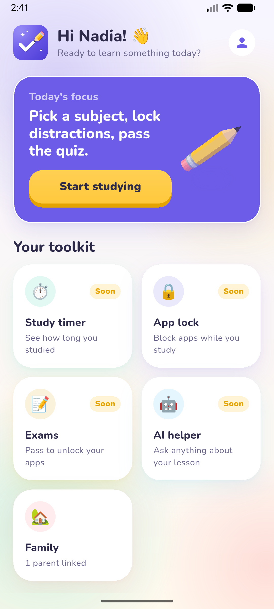
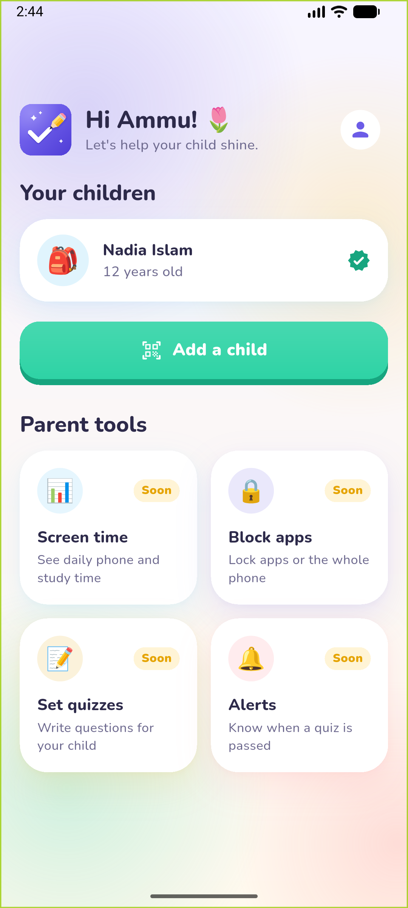

<div align="center">


# Study Assistant

**Study smart. Unlock by learning.**

Pick what you'll study, lock distracting apps, and win them back by passing a quick AI quiz.

[](https://github.com/Ashfaq1306/study-assistant/actions/workflows/ci.yml)


</div>

---

## How it works



- **You set the rules.** Choose the exam pattern, total marks and pass mark. The pass mark can be anything from 50% up.
- **No shortcuts.** A locked app stays locked until the exam is passed.
- **Family built in.** Students under 15 link a parent by QR code. Parents can see screen time, block apps and write their own questions.
- **An AI study buddy.** Ask questions about what you're learning, any time.

## Screenshots

<table>
  <tr>
    <td align="center"><br/><sub>Welcome: spinning 3D pencil</sub></td>
    <td align="center"><br/><sub>Signup knows when you're under 15</sub></td>
    <td align="center"><br/><sub>6-digit code by email or SMS</sub></td>
  </tr>
  <tr>
    <td align="center"><br/><sub>Under 15: a parent scans to link</sub></td>
    <td align="center"><br/><sub>Student home</sub></td>
    <td align="center"><br/><sub>Parent home</sub></td>
  </tr>
</table>

## Features

| | Feature | Status |
| --- | --- | --- |
| 👤 | Accounts with email **or** SMS one-time codes, password reset | ✅ Done |
| 👨‍👩‍👧 | Parent ↔ student linking by QR (required under 15) | ✅ Done |
| 🎨 | 3D design system: spinning 3D pencil mascot, chunky 3D buttons, clay cards | ✅ Done |
| ⏱️ | Study sessions: subject and topics, timer on server time, finish-early rule, stats, streaks and history | ✅ Done |
| 🔒 | App blocker (Android accessibility and usage-access service) | 🔜 Phase 3 |
| 📝 | AI-generated exams, custom pattern and marks, pass mark ≥ 50% | 🔜 Phase 4 |
| 🤖 | AI study helper | 🔜 Phase 4 |
| 📊 | Parent dashboard: screen time, remote block, parent-written questions | 🔜 Phase 5 |
| 🛠️ | Admin panel (users, content, settings, analytics) | 🔜 Phase 6 |

## Tech stack

| Part | Stack |
| --- | --- |
| **App** (`app/`) | Flutter 3.47, Riverpod 3, go_router 18, dio, flutter_secure_storage, mobile_scanner, qr_flutter |
| **API** (`backend/`) | Node 24, TypeScript, Fastify 5, Prisma 6, zod 4, vitest |
| **Data** | SQLite for development; Postgres for production |
| **Delivery** | SMTP email, Twilio SMS (both swappable; console output in development) |

More detail in [docs/architecture.md](docs/architecture.md) and the [API reference](docs/api.md).

## Getting started

### Prerequisites
- [Node.js 24](https://nodejs.org) and [Flutter 3.47+](https://docs.flutter.dev/get-started/install) with the Android SDK
- An Android phone with **USB debugging** on, or an emulator

### 1. Run the API
```bash
cd backend
npm ci
cp .env.example .env        # then set JWT_SECRET and OTP_SECRET (the file says how)
npm run db:push             # creates the local SQLite database
npm run dev                 # http://localhost:8080
```
In development, one-time codes are **printed in the API log** instead of being emailed or texted (look for `DEV OTP`). With `EXPOSE_DEV_CODES=true` (set in `.env.example`, refused in production) the app also shows the code on screen, so you can test on a phone without email or SMS.

### 2. Run the app
```bash
cd app
flutter pub get
adb reverse tcp:8080 tcp:8080   # lets the phone or emulator reach the API on your computer
flutter run                      # add --release to see real speed
```

### Production settings
- **API:** set `NODE_ENV=production`, `TRUST_PROXY` to the number of proxies in front of the API (rate limits depend on the real client IP), a Postgres `DATABASE_URL` (and change the Prisma `provider`), real secrets, `EMAIL_PROVIDER=smtp` with `SMTP_*`, and `SMS_PROVIDER=twilio` with `TWILIO_*`. Console providers are refused in production.
- **App:** `flutter build apk --release --dart-define=API_BASE_URL=https://your-api.example.com`

## Testing
```bash
cd backend && npm run lint && npm run typecheck && npm test   # API tests
cd app && flutter analyze && flutter test test                 # app tests
```
CI runs the same checks on every pull request.

## Project structure
```
study-assistant/
├── app/                  Flutter app
│   ├── lib/app/          router, route guard, providers
│   ├── lib/core/         network, storage, theme, 3D widgets
│   ├── lib/features/     auth · family · home  (data / domain / application / presentation)
│   └── tool/icon/        draws the launcher icons from code
├── backend/              REST API
│   ├── prisma/           database schema
│   ├── src/modules/      auth · users · family · notify
│   └── test/             API tests
├── docs/                 architecture and assets
└── .claude/agents/       junior-coder · senior-coder · code-reviewer · qa-tester
```

## Contributing
Every change goes through a **junior → senior → reviewer → QA** pipeline and lands as a pull request. See [CONTRIBUTING.md](CONTRIBUTING.md) and [CLAUDE.md](CLAUDE.md).

## Security
- Passwords are hashed with scrypt. One-time codes and pairing codes are stored only as HMACs.
- Refresh tokens rotate on use; reusing an old one signs out every device in that session.
- Login answers the same way for unknown accounts and wrong passwords, and password reset never reveals whether an account exists.
- Sensitive endpoints are rate-limited per IP, and one-time codes per destination. Parallel guessing cannot get more than 5 tries.
- Only contacts that have received a code can be used to sign in or reset a password.
- On the phone, tokens are kept in the Android Keystore through `flutter_secure_storage`.
