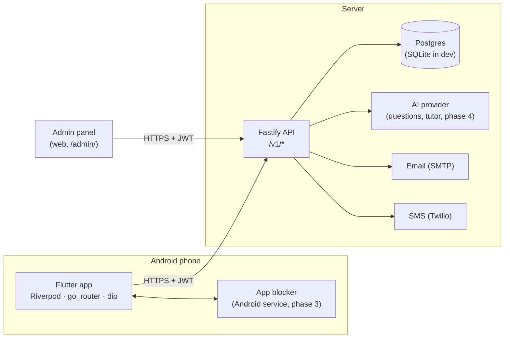
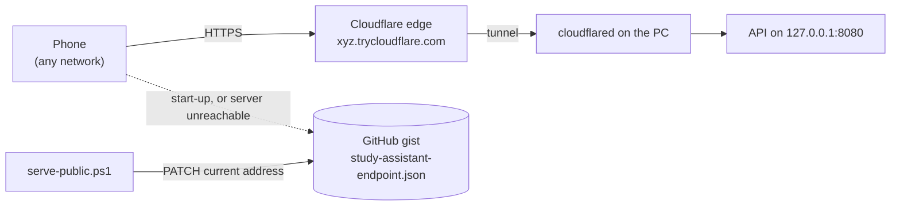

# Architecture

## Accounts and sessions
- **Signup:** `POST /v1/auth/register` creates an *unverified* user and sends a 6-digit code by the channel the user picked. `POST /v1/auth/verify` opens the account and returns tokens.
- **Abandoned signups** never lock anyone out: registering again with the same email or phone replaces the unverified account. Code limits are kept per destination in `OtpSend`, so re-registering cannot be used to flood a phone.
- **Verified contacts only:** a code proves control of one contact (`emailVerifiedAt` / `phoneVerifiedAt`). Only verified contacts work for login and password reset, and an unverified one is released if its real owner signs up.
- **One-time codes:** each guess claims an attempt atomically before the code is compared, so parallel guessing cannot exceed 5 tries.
- **Tokens:** a 15-minute JWT access token plus an opaque 30-day refresh token. Refresh tokens rotate on every use and only their SHA-256 hash is stored. Presenting an already-rotated token revokes the whole session family (theft detection). A password reset revokes every session.
- **App side:** `ApiClient` attaches the token and, on a 401, refreshes once (concurrent requests share one in-flight refresh) and retries. If the server rejects the refresh, the user is signed out. If the network is down, the session is kept.

## Parental control
- The student's app calls `POST /v1/family/pairing-code` and shows the result as a QR (`studyassistant://pair?code=XXXXXXXX`) plus a typeable code. Codes use Crockford base32, are single-use, expire after 10 minutes, and are stored only as an HMAC.
- The parent's app scans the QR (or the parent types the code) → `POST /v1/family/links`.
- **Under 15:** `GET /v1/me` reports `parentalControl.required = true`. The app's route guard (`guardRoute`) keeps the student on the link screen until `linkedParents > 0`, and the server refuses to let such a student remove their last parent.

## Error contract
Every error is `{ "error": { "code": "OTP_INVALID", "message": "That code is not right.", "details": { … } } }`. `message` is written for end users. Validation errors put per-field messages in `details.fields`.

| Code | When |
| --- | --- |
| `VALIDATION_FAILED` | Bad input; see `details.fields` |
| `EMAIL_TAKEN` / `PHONE_TAKEN` | Already used by a verified account |
| `INVALID_CREDENTIALS` | Wrong identifier or password (same message for both) |
| `ACCOUNT_NOT_VERIFIED` | Right password, code not entered yet; `details.userId` lets the app continue |
| `OTP_INVALID` / `OTP_EXPIRED` / `OTP_TOO_MANY_ATTEMPTS` / `OTP_RESEND_TOO_SOON` | One-time code problems |
| `PAIRING_CODE_INVALID` / `ALREADY_LINKED` / `TOO_MANY_PARENTS` | Family linking |
| `OTP_CHANNEL_OFF` | This server cannot send codes that way (no SMS provider) |
| `CANNOT_DISABLE_SELF` / `CANNOT_MANAGE_ADMIN` / `NOT_A_STUDENT` | Control Room account actions |
| `UNAUTHORIZED` / `FORBIDDEN` / `RATE_LIMITED` | Access control |

## App blocker (Android)
- **The server decides.** A phone registers with `POST /v1/devices` and gets its own device token. `GET /v1/device/state` (or the heartbeat) returns what to block: the running session's apps, a parent's lock, or the whole phone (`*`).
- **The phone enforces.** `AppLockService` is an accessibility service that only listens for window changes; it never reads screen content. When a locked app comes to the front, it goes home and opens Study Mate's lock screen. A re-check catches apps that open a second window while starting.
- **Sync** runs natively every minute, so a lock starts and ends even when the app is closed. Offline, the last known state keeps applying; staying locked is the safe default.
- **Never blocked:** this app, the launcher, the keyboard, the phone dialer, in-call screens and emergency apps.
- **Strict mode** (always on for under-15s) also blocks Settings, app stores, the uninstaller and the permission controller. Wi-Fi, mobile data and the Internet panel stay reachable so the student can get online for the exam. Only real activity windows decide, because splash windows say nothing about which screen is opening.
- **No escape hatches:**
  - Signing out keeps the lock.
  - Signing in as another account cannot replace a running lock (the server is asked, not a cached flag).
  - A phone cannot be removed from the account while it is locked (`409 LOCK_ACTIVE`).
  - Only the server's `DEVICE_UNAUTHORIZED` makes a phone forget its token; any other 401 keeps the lock.
- **Already-open apps:** while a lock is on and the screen is on, every visible app window (full screen, split screen, pop-up) is re-checked every 1.5 s; a window that survives going home is retried after 6 s instead of in a loop. The service reads only which package owns each window, never what is inside it.
- **Safety:** whole-phone mode only blocks apps with a launcher icon, so emergency (cell broadcast) alerts, Wi-Fi sign-in (captive portal) pages and the SIM toolkit always work. The service catches its own errors: a crash would unbind it and end every lock.
- **Accessibility shortcut:** if the student turns on a shortcut for the service (volume keys, accessibility button, quick setting), it could switch the lock off without Settings. The app detects this, shows "turn off the shortcut", reports `shortcutOn` to the server, and treats protection as not ready.
- **Known limits** (an accessibility-based blocker can't prevent these without device-owner rights):
  - Rebooting into Android safe mode starts no third-party services. The server sees heartbeats stop and `protectionOn` go false; parent alerts for this come with parent controls (phase 5).
  - A video already floating in picture-in-picture when a lock starts is not closed; the lock screen comes up behind it.
  - Calls come first: while the dialer or an in-call screen is the focused window, the re-check pauses, so a locked app in the other split-screen half waits until the call screen loses focus (opening it there is still blocked).
  - Settings screens are judged by the last screen seen in Settings, which is right on phones (one Settings task); two Settings windows side by side on a large screen could be judged by the other one.

## The 3D look
There is no 3D engine. `Pencil3D` is a hand-built mesh (an 18-sided eraser and ferrule, a hexagonal body, a sharpened cone and a graphite tip) projected with perspective in a `CustomPainter`. It uses back-face culling, painter's-algorithm depth sorting and Blinn-Phong shading tinted violet. Buttons (`Button3D`) have a physical bottom edge that sinks on press, and cards (`ClayCard`) use soft coloured "clay" shadows.

## Reaching the server from any network
The API can run on a home computer and still work for phones on any Wi-Fi or mobile data:

- **`scripts/serve-public.ps1`** starts the API bound to `127.0.0.1` only (nothing on the LAN reaches it directly), opens a Cloudflare *quick tunnel* (free, no account, HTTPS), and writes the tunnel's address to a gist. Every 30 s it checks both and restarts whichever died; a tunnel that is unreachable from outside three times in a row is replaced. `scripts/install-autostart.ps1` runs it at every Windows sign-in. Logs: `%LOCALAPPDATA%\StudyAssistant\logs`.
- **The app** is built with `API_DISCOVERY_URL` (the gist's raw URL). `ApiEndpoint` starts from the last address that worked (cached on the phone), reads the file at start-up, and reads it again whenever a request gets no answer or Cloudflare's `530/502/503` for a dead tunnel; the request is then retried once at the new address. Reads are shared and at most one per 15 s. Only `https://` addresses are accepted from the file, so it can never downgrade the app to plain HTTP.
- **The native lock sync** (it runs with the app closed) does the same: when a heartbeat gets no answer it reads the file (at most every 2 minutes), stores the new address and retries.
- **A permanent link:** https://ashfaq1306.github.io/study-mate/admin/ (GitHub Pages, `gh-pages` branch) reads the same gist and forwards to `<current address>/admin/`. `/health` allows cross-origin reads so that page can check the server is up.
- **Logs** are kept across restarts (the last 10 of each, timestamped) in `%LOCALAPPDATA%StudyAssistantogs`.
- **Rate limits** see the real phone IP: cloudflared adds `X-Forwarded-For` and `TRUST_PROXY=1`.
- **Limits:** the computer must be on, awake and online. A quick tunnel has no uptime guarantee; when it drops, the watchdog opens a new one and phones follow within a minute or two. For always-on hosting, deploy the API to a cloud host with Postgres and build the app with that `API_BASE_URL` (no discovery file needed).

## Admin panel (the Control Room)
`admin/` is a dependency-free web app (HTML, CSS and one ES module) that the API serves at **`/admin/`**, so it shares the API's origin: no CORS and the same HTTPS tunnel. It has its own look (dark slate and cyan), deliberately unlike the student app. Files are read once at start-up from `ADMIN_PANEL_DIR` (default `../admin`); only names in that folder can be served.

- **In the app:** an ADMIN account that signs in to the phone app goes straight to `AdminPanelScreen`, which shows the Control Room in a WebView, and the route guard keeps it there (and keeps everyone else out). The app asks `POST /v1/admin/panel-session` for a *separate* session and puts it in the page's `sessionStorage`, so the app and the panel never share, and rotate, one refresh token. Signing out in the panel signs the app out too. Admins never register a phone or sync study data.
- **In a browser:** sign in with the admin ID and password. Non-admin accounts are refused (and their new session revoked). Tokens live in `sessionStorage` and refresh on a `401`.
- **Overview:** who is online now, who is signed in, minutes studied today, accounts, pass rate, a 14-day chart of minutes studied.
- **Accounts:** search and filter by role, status and presence (online, signed in, signed out). Each account shows its last activity, the devices it is signed in on, its sign-in history, study time per subject, sessions, exams, phones, family links and lock state, with these controls:
  - **Unlock phone** (students): the owner's override of the exam rule; see the API reference. It asks for confirmation and an optional reason, and it is logged.
  - **Sign out everywhere**, **Reset password** (a new random password is shown to the admin once), **Disable / Enable**.
  - Admin accounts can't be changed from the panel.
- **Study time:** every student's minutes and sessions for the last 24 h, 7 days, 30 days or all time, with their top subjects, plus totals per subject.
- **Activity log:** every sign-up, sign-in, sign-out and password reset (time, device, IP) and every admin action (who did it, why).
- **Settings:** pass-mark floor (≥ 50%), study time limits, finish-early share, exam size, retry wait, AI helper limit, AI on/off, subjects, in-app announcement.

**How it is recorded:** `ActivityService` writes `ActivityEvent` rows from the auth routes and admin actions; a failed write is logged and never fails the request. `requireAuth` stamps `User.lastActiveAt` (at most every 2 minutes, not awaited). Live sessions are `Session` rows that are not revoked, not rotated and not expired.

**Admins** are created on the server only: `npm run admin -- create <email> "<name>"` prints a one-time password; `promote <email>` upgrades an existing verified account; `reset-password <email>` and `list` exist too. All user text in the panel is rendered with `textContent`, never as HTML, and Helmet's CSP allows only same-origin scripts.
