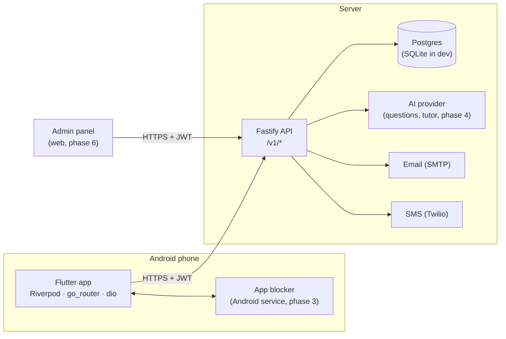

# Architecture

## Accounts and sessions
- **Signup:** `POST /v1/auth/register` creates an *unverified* user and sends a 6-digit code by the channel the user picked. `POST /v1/auth/verify` opens the account and returns tokens.
- **Abandoned signups** never lock anyone out: registering again with the same email or phone replaces the unverified account. Code limits are kept per destination in `OtpSend`, so re-registering cannot be used to flood a phone.
- **Verified contacts only:** a code proves control of one contact (`emailVerifiedAt` / `phoneVerifiedAt`). Only verified contacts work for login and password reset, and an unverified one is released if its real owner signs up.
- **One-time codes:** each guess claims an attempt atomically before the code is compared, so parallel guessing cannot exceed 5 tries.
- **Tokens:** a 15-minute JWT access token plus an opaque 30-day refresh token. Refresh tokens rotate on every use and only their SHA-256 hash is stored. Presenting an already-rotated token revokes the whole session family (theft detection). A password reset revokes every session.
- **App side:** `ApiClient` attaches the token and, on a 401, refreshes once (concurrent requests share one in-flight refresh) and retries. If the server rejects the refresh, the user is signed out. If the network is down, the session is kept.

## Parental control
- The student's app calls `POST /v1/family/pairing-code` and shows the result as a QR (`studyassistant://pair?code=XXXXXXXX`) plus a typeable code. Codes use Crockford base32, are single-use, expire after 10 minutes, and are stored only as an HMAC.
- The parent's app scans the QR (or the parent types the code) → `POST /v1/family/links`.
- **Under 15:** `GET /v1/me` reports `parentalControl.required = true`. The app's route guard (`guardRoute`) keeps the student on the link screen until `linkedParents > 0`, and the server refuses to let such a student remove their last parent.

## Error contract
Every error is `{ "error": { "code": "OTP_INVALID", "message": "That code is not right.", "details": { … } } }`. `message` is written for end users. Validation errors put per-field messages in `details.fields`.

| Code | When |
| --- | --- |
| `VALIDATION_FAILED` | Bad input; see `details.fields` |
| `EMAIL_TAKEN` / `PHONE_TAKEN` | Already used by a verified account |
| `INVALID_CREDENTIALS` | Wrong identifier or password (same message for both) |
| `ACCOUNT_NOT_VERIFIED` | Right password, code not entered yet; `details.userId` lets the app continue |
| `OTP_INVALID` / `OTP_EXPIRED` / `OTP_TOO_MANY_ATTEMPTS` / `OTP_RESEND_TOO_SOON` | One-time code problems |
| `PAIRING_CODE_INVALID` / `ALREADY_LINKED` / `TOO_MANY_PARENTS` | Family linking |
| `UNAUTHORIZED` / `FORBIDDEN` / `RATE_LIMITED` | Access control |

## The 3D look
There is no 3D engine. `Pencil3D` is a hand-built mesh (an 18-sided eraser and ferrule, a hexagonal body, a sharpened cone and a graphite tip) projected with perspective in a `CustomPainter`. It uses back-face culling, painter's-algorithm depth sorting and Blinn-Phong shading tinted violet. Buttons (`Button3D`) have a physical bottom edge that sinks on press, and cards (`ClayCard`) use soft coloured "clay" shadows.
